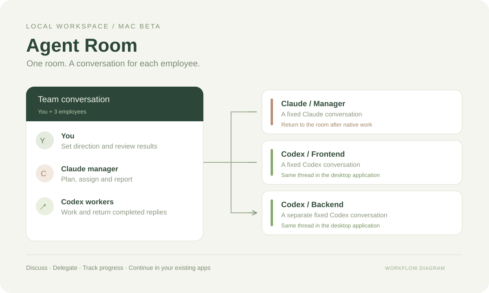

# Agent Room · Mac beta 0.2

[中文](README.md) · [Website](https://nickstudio.cn/en/agent-room.html) · [Download](https://github.com/lun79345-dotcom/agent-room/releases/tag/v0.2.0)

A local team room for you, a Claude manager and Codex workers. Each employee stays linked to one conversation. Discuss, delegate and review progress in the room, then open the same conversation in your existing desktop application.



This is an independent project, unaffiliated with OpenAI or Anthropic.

## Start on your Mac

1. Install Node.js 22 or later, Claude Code and Codex CLI from their official sources. Sign in to each CLI with your own account. Desktop-app sign-in may not also sign you into the CLI.
2. Download and extract the Mac beta ZIP. Keep the entire folder together.
3. Open `开始使用.html` for the setup guide, then double-click `启动员工群.command` to start. The room uses a local address, normally `http://127.0.0.1:4319`; occupied ports are skipped.
4. Open the setup check in the header. It checks installed programs, sign-in, required interfaces and project folders. If necessary, enter full executable paths. This check makes no model requests and cannot verify network availability or remaining usage limits.

Claude Desktop and Codex desktop are needed to continue in the original application. The original-app message queue requires a compatible Codex build; it is experimental. The verified baseline was macOS, Node.js 26.11.0, Codex CLI 0.162.0-alpha.2 and Claude Code 2.1.295. The app checks capabilities rather than assuming that a newer version is compatible.

## Working together

- **Discussion**: contact one employee or everyone. Each employee retains their conversation context.
- **Delegate work**: give the Claude manager a concrete task. The manager assigns Codex workers and summarizes their results once that batch finishes.
- **Continue in the original app**: open an employee's linked conversation. Codex room messages can be queued into that same desktop conversation, with completed replies returning to the room. Claude currently needs to return to the room after native-app work to resume managing workers.
- **Recover**: manually retry failed discussions or continue interrupted tasks. Task continuation retains its identity and attempts, and asks the worker to inspect existing changes first. Restarting does not automatically rerun work.
- **Manage the local service**: `重新启动群聊.command` restarts this folder's service and `停止员工群.command` stops it. Ongoing room work prevents immediate shutdown.

Each user runs their own local room and uses their own model accounts and usage limits. This beta is not a shared internet chat service. Set employee project folders in their settings; the default is `workspace/`. Workers do not yet get separate Git worktrees automatically, so avoid simultaneous edits to the same files.

## Implementation and data

The server has no third-party runtime dependencies. Codex uses official app-server JSON-RPC and persistent threads. When the desktop app owns a thread, room messages use its experimental queue rather than competing for the thread writer. Claude uses persistent CLI sessions; `claude --desktop --resume <id>` opens the same session in Claude Desktop.

Room history, employee bindings, tasks and executable-path settings stay in `.data/`. Native model conversations remain in each provider's own storage. The server binds to `127.0.0.1`, checks request origins and requires a page token for mutations. It synchronizes completed assistant text, not private reasoning or full tool logs, and only reads conversations linked to employees.

Direct room discussion uses read-only Codex settings. Delegated work uses the employee's project folder with network access disabled by default. Turns queued into the desktop app inherit that app's own permissions and approval flow. Claude room turns have execution tools and user plugins disabled.

## Develop and package

```sh
npm start
npm test
npm run package:mac
```

The 14 automated checks cover assignment constraints, retained sessions, recovery, event isolation, native queue matching and cancellation, and startup checks. Fresh extraction, repeat launch, restart and configuration recovery were also checked on the development Mac. Cross-device and long-running verification remain pending.

The package uses an explicit file list. It excludes `.data`, account credentials, linked sessions, project files, installed programs and developer screenshots. Node.js and model applications are not bundled, and the ZIP is not a signed installer.

The experimental queue and native conversation formats can change. Claude cannot yet directly call the room's task-assignment interface from its desktop conversation. Model calls use the signed-in account's limits; commercial or hosted services need provider-supported authorization. See the official [Codex app-server authentication documentation](https://learn.chatgpt.com/docs/app-server#auth-endpoints) and [Claude CLI reference](https://code.claude.com/docs/en/cli-reference).
